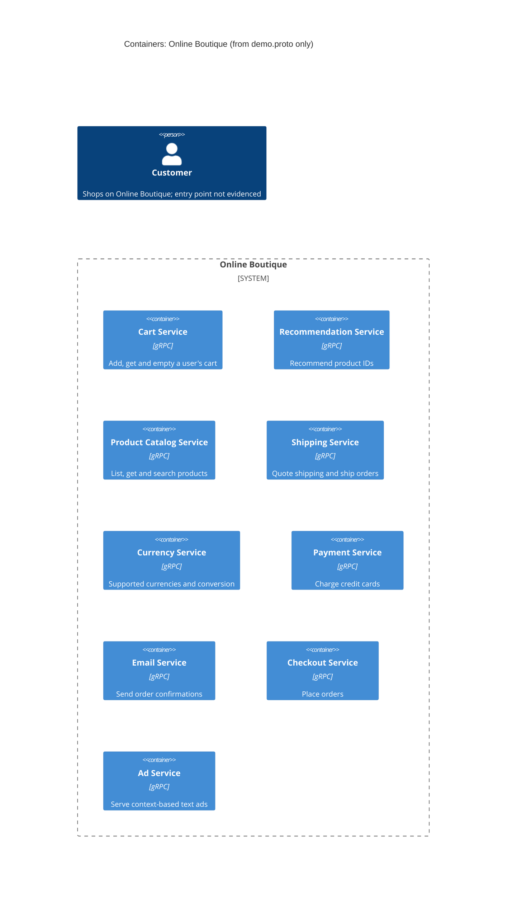

# Task 1 (Run A): Recovered architecture of Online Boutique

## 1. Agent

Claude Code (Anthropic), model `claude-opus-5-5`.

## 2. Files read

- `prompts/1-recover-architecture.md` (task file)
- `system/online-boutique/protos/demo.proto` (the only evidence)

## 3. Containers table

The proto file defines gRPC service *interfaces*. It does not say what each service is written in, how it is deployed, or what data stores it uses. "gRPC" is evidenced by the `service … { rpc … }` definitions (`syntax = "proto3"`, line 15). Implementation language is **not evidenced** for any service.

| Container | Technology / language | Responsibility | Evidence |
|---|---|---|---|
| Cart Service | gRPC (proto3); language not evidenced | Adds items to a user's cart, returns the cart, empties the cart | `system/online-boutique/protos/demo.proto` (`service CartService`: `AddItem`, `GetCart`, `EmptyCart`, lines 23-27) |
| Recommendation Service | gRPC (proto3); language not evidenced | Returns recommended product IDs for a user and a list of product IDs | `system/online-boutique/protos/demo.proto` (`service RecommendationService`: `ListRecommendations`, lines 56-58) |
| Product Catalog Service | gRPC (proto3); language not evidenced | Lists, gets and searches products (id, name, description, picture, price, categories) | `system/online-boutique/protos/demo.proto` (`service ProductCatalogService`: `ListProducts`, `GetProduct`, `SearchProducts`, lines 71-75; `message Product`, lines 77-87) |
| Shipping Service | gRPC (proto3); language not evidenced | Quotes shipping cost for an address and items; ships an order and returns a tracking ID | `system/online-boutique/protos/demo.proto` (`service ShippingService`: `GetQuote`, `ShipOrder`, lines 107-110) |
| Currency Service | gRPC (proto3); language not evidenced | Lists supported currencies; converts `Money` between ISO 4217 currencies | `system/online-boutique/protos/demo.proto` (`service CurrencyService`: `GetSupportedCurrencies`, `Convert`, lines 140-143) |
| Payment Service | gRPC (proto3); language not evidenced | Charges an amount to a credit card and returns a transaction ID | `system/online-boutique/protos/demo.proto` (`service PaymentService`: `Charge`, lines 177-179; `ChargeRequest`, lines 188-191) |
| Email Service | gRPC (proto3); language not evidenced | Sends an order confirmation to an email address | `system/online-boutique/protos/demo.proto` (`service EmailService`: `SendOrderConfirmation`, lines 199-201) |
| Checkout Service | gRPC (proto3); language not evidenced | Places an order for a user (currency, address, email, credit card) and returns an `OrderResult` | `system/online-boutique/protos/demo.proto` (`service CheckoutService`: `PlaceOrder`, lines 224-226; `PlaceOrderRequest`, lines 228-235) |
| Ad Service | gRPC (proto3); language not evidenced | Returns text ads (text + redirect URL) for a list of page context keywords | `system/online-boutique/protos/demo.proto` (`service AdService`: `GetAds`, lines 243-245) |

Data stores: **Not evidenced in the provided files.** The proto defines no database, cache or message broker.

## 4. Dependencies table

A proto file declares what each service *offers*. It does not record which service *calls* which. **No runtime dependency is evidenced in the provided files**, so this table is empty on purpose.

| Caller → callee | Protocol | Evidence |
|---|---|---|
| *(none evidenced)* | n/a | `demo.proto` has only server-side `service` definitions, no client wiring |

Dependencies that look likely but are only **[Inferred]** from shared message types are listed under **Gaps** and left out of the diagram.

## 5. Mermaid diagram

The diagram has no `Rel` lines because the Dependencies table has none. The `Person` is included as the template requires, but the evidence doesn't show how the user reaches the system: there is no frontend or UI service in the proto.

## 6. Gaps

| Gap | Why it is a gap | File that would settle it |
|---|---|---|
| Caller → callee dependencies | The proto lists services but no clients | `system/online-boutique/kubernetes-manifests/*.yaml` (`*_SERVICE_ADDR` env vars), or each service's source under `system/online-boutique/src/` |
| **[Inferred]** `checkoutservice` → cart, catalog, currency, shipping, payment, email | `PlaceOrderRequest` carries `user_id`, `user_currency`, `Address`, `email` and `CreditCardInfo`, and returns `OrderResult` with `shipping_tracking_id` and `OrderItem` costs (lines 208-239). These match `GetCart`/`EmptyCart`, `GetProduct`, `Convert`, `GetQuote`/`ShipOrder`, `Charge` and `SendOrderConfirmation`. Shared types are not proof of calls | `system/online-boutique/src/checkoutservice/` source, or `kubernetes-manifests/checkoutservice.yaml` |
| **[Inferred]** `recommendationservice` → `productcatalogservice` | `ListRecommendationsRequest` passes `product_ids`, and `Product.categories` is commented as used "to look up other related products" (lines 84-86). Not proof of a call | `system/online-boutique/src/recommendationservice/` source or its manifest |
| Frontend / UI container and how the `Customer` reaches the system | No frontend service in the proto; the protocol from user to system is unknown | `system/online-boutique/kubernetes-manifests/frontend.yaml`, `system/online-boutique/src/frontend/` |
| Who calls `AdService`, `CurrencyService.GetSupportedCurrencies`, `ProductCatalogService.ListProducts/SearchProducts`, `CartService.AddItem` | Probably a UI-facing caller **[Inferred]**, but none is defined | Same as above (frontend manifest and source) |
| Implementation language of each service | Proto is language-neutral; only `go_package` (line 19) shows Go code is generated, not which services use it | `system/online-boutique/src/*/` (e.g. `go.mod`, `package.json`, `requirements.txt`, `build.gradle`, `*.csproj`) or Dockerfiles |
| Data stores (e.g. where cart state lives) | No storage is defined in the proto | `system/online-boutique/kubernetes-manifests/` (e.g. a cart DB or cache deployment, `REDIS_ADDR`-style env vars), `src/cartservice/` |
| External systems (real payment gateway, email provider) | `Charge` and `SendOrderConfirmation` might be mocks or call third parties; not shown | `src/paymentservice/`, `src/emailservice/` source |
| Asynchronous messaging | Only unary gRPC RPCs are defined; no broker evidenced | Manifests or source |
