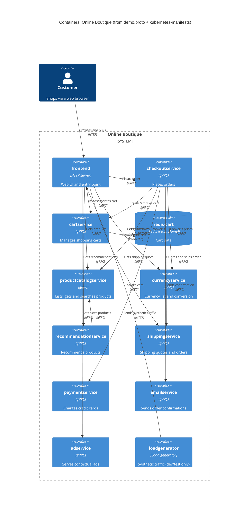

# Task 1B: Recovered C4 container architecture (Online Boutique)

## Agent

Claude Code (Anthropic), model `claude-opus-5-5`.

## Files read

- `prompts/1-recover-architecture.md` (task file)
- `system/online-boutique/protos/demo.proto`
- `system/online-boutique/kubernetes-manifests/kustomization.yaml`
- `system/online-boutique/kubernetes-manifests/README.md`
- `system/online-boutique/kubernetes-manifests/adservice.yaml`
- `system/online-boutique/kubernetes-manifests/cartservice.yaml`
- `system/online-boutique/kubernetes-manifests/checkoutservice.yaml`
- `system/online-boutique/kubernetes-manifests/currencyservice.yaml`
- `system/online-boutique/kubernetes-manifests/emailservice.yaml`
- `system/online-boutique/kubernetes-manifests/frontend.yaml`
- `system/online-boutique/kubernetes-manifests/loadgenerator.yaml`
- `system/online-boutique/kubernetes-manifests/paymentservice.yaml`
- `system/online-boutique/kubernetes-manifests/productcatalogservice.yaml`
- `system/online-boutique/kubernetes-manifests/recommendationservice.yaml`
- `system/online-boutique/kubernetes-manifests/shippingservice.yaml`

Note: no directory-listing tool was available, so the manifest files were opened by name, guided by the `resources:` list in `kustomization.yaml`. A file in the folder that is not in that list may have been missed (see **Gaps**).

## Containers table

Implementation language is **Not evidenced in the provided files** for any service: the manifests reference only image names such as `image: frontend`, and `demo.proto` is language-neutral. "Technology" below therefore gives the interface/runtime that *is* evidenced.

| Container | Technology / language | Responsibility | Evidence |
|---|---|---|---|
| `frontend` | HTTP server on port 8080, exposed via `LoadBalancer`; language not evidenced | Web UI / entry point for shoppers; calls the backend services | `kubernetes-manifests/frontend.yaml` (Deployment `frontend`, Service `frontend-external` type `LoadBalancer`, port name `http`, probe `httpGet /_healthz`) |
| `cartservice` | gRPC server on port 7070; language not evidenced | Store and return a user's cart (`AddItem`, `GetCart`, `EmptyCart`) | `protos/demo.proto` (`service CartService`); `kubernetes-manifests/cartservice.yaml` (Service port name `grpc`, 7070) |
| `redis-cart` | Redis (`redis:alpine`), port 6379, `emptyDir` volume | Data store for cart data | `kubernetes-manifests/cartservice.yaml` (Deployment `redis-cart`, `image: redis:alpine`, volume `redis-data: emptyDir`) |
| `productcatalogservice` | gRPC server on port 3550; language not evidenced | List, get and search products (`ListProducts`, `GetProduct`, `SearchProducts`) | `protos/demo.proto` (`service ProductCatalogService`); `kubernetes-manifests/productcatalogservice.yaml` (port name `grpc`, 3550) |
| `currencyservice` | gRPC server on port 7000; language not evidenced | Supported currencies and currency conversion (`GetSupportedCurrencies`, `Convert`) | `protos/demo.proto` (`service CurrencyService`); `kubernetes-manifests/currencyservice.yaml` (port name `grpc`, 7000) |
| `recommendationservice` | gRPC server on port 8080; language not evidenced | Recommend product IDs (`ListRecommendations`) | `protos/demo.proto` (`service RecommendationService`); `kubernetes-manifests/recommendationservice.yaml` (port name `grpc`, 8080) |
| `shippingservice` | gRPC server on port 50051; language not evidenced | Shipping quotes and shipping orders (`GetQuote`, `ShipOrder`) | `protos/demo.proto` (`service ShippingService`); `kubernetes-manifests/shippingservice.yaml` (port name `grpc`, 50051) |
| `checkoutservice` | gRPC server on port 5050; language not evidenced | Place an order (`PlaceOrder`), orchestrating cart, catalog, currency, shipping, payment and email | `protos/demo.proto` (`service CheckoutService`); `kubernetes-manifests/checkoutservice.yaml` (port name `grpc`, 5050; six `*_SERVICE_ADDR` env vars) |
| `paymentservice` | gRPC server on port 50051; language not evidenced | Charge a credit card (`Charge`) | `protos/demo.proto` (`service PaymentService`); `kubernetes-manifests/paymentservice.yaml` (port name `grpc`, 50051) |
| `emailservice` | gRPC server (Service port 5000 → container 8080); language not evidenced | Send order confirmation (`SendOrderConfirmation`) | `protos/demo.proto` (`service EmailService`); `kubernetes-manifests/emailservice.yaml` (port name `grpc`, 5000→8080) |
| `adservice` | gRPC server on port 9555; language not evidenced | Return context-based ads (`GetAds`) | `protos/demo.proto` (`service AdService`); `kubernetes-manifests/adservice.yaml` (port name `grpc`, 9555) |
| `loadgenerator` | Container with no Service; language not evidenced | Generates synthetic user traffic against the frontend (`USERS=10`, `RATE=1`). Commented out of `kustomization.yaml` ("skaffold ... will be used"), so it is a dev/test tool, not part of the default deployment | `kubernetes-manifests/loadgenerator.yaml` (Deployment `loadgenerator`); `kubernetes-manifests/kustomization.yaml` line 24 |

## Dependencies table

Protocol for service-to-service calls is gRPC: each callee's Service port is named `grpc`, its probes are `grpc:` probes, and it implements a `service` in `demo.proto`. Which RPCs each caller actually invokes is **Not evidenced in the provided files** (manifests show only the address).

| Caller → callee | Protocol | Evidence |
|---|---|---|
| Customer → `frontend` | HTTP (port 80 → 8080) | `kubernetes-manifests/frontend.yaml` (Service `frontend-external`, `type: LoadBalancer`, port name `http`) |
| `loadgenerator` → `frontend` | HTTP | `kubernetes-manifests/loadgenerator.yaml` (`FRONTEND_ADDR=frontend:80`; init container `wget http://${FRONTEND_ADDR}`) |
| `frontend` → `productcatalogservice` | gRPC | `kubernetes-manifests/frontend.yaml` (`PRODUCT_CATALOG_SERVICE_ADDR=productcatalogservice:3550`) |
| `frontend` → `currencyservice` | gRPC | `kubernetes-manifests/frontend.yaml` (`CURRENCY_SERVICE_ADDR=currencyservice:7000`) |
| `frontend` → `cartservice` | gRPC | `kubernetes-manifests/frontend.yaml` (`CART_SERVICE_ADDR=cartservice:7070`) |
| `frontend` → `recommendationservice` | gRPC | `kubernetes-manifests/frontend.yaml` (`RECOMMENDATION_SERVICE_ADDR=recommendationservice:8080`) |
| `frontend` → `shippingservice` | gRPC | `kubernetes-manifests/frontend.yaml` (`SHIPPING_SERVICE_ADDR=shippingservice:50051`) |
| `frontend` → `checkoutservice` | gRPC | `kubernetes-manifests/frontend.yaml` (`CHECKOUT_SERVICE_ADDR=checkoutservice:5050`) |
| `frontend` → `adservice` | gRPC | `kubernetes-manifests/frontend.yaml` (`AD_SERVICE_ADDR=adservice:9555`) |
| `checkoutservice` → `productcatalogservice` | gRPC | `kubernetes-manifests/checkoutservice.yaml` (`PRODUCT_CATALOG_SERVICE_ADDR=productcatalogservice:3550`) |
| `checkoutservice` → `shippingservice` | gRPC | `kubernetes-manifests/checkoutservice.yaml` (`SHIPPING_SERVICE_ADDR=shippingservice:50051`) |
| `checkoutservice` → `paymentservice` | gRPC | `kubernetes-manifests/checkoutservice.yaml` (`PAYMENT_SERVICE_ADDR=paymentservice:50051`) |
| `checkoutservice` → `emailservice` | gRPC | `kubernetes-manifests/checkoutservice.yaml` (`EMAIL_SERVICE_ADDR=emailservice:5000`) |
| `checkoutservice` → `currencyservice` | gRPC | `kubernetes-manifests/checkoutservice.yaml` (`CURRENCY_SERVICE_ADDR=currencyservice:7000`) |
| `checkoutservice` → `cartservice` | gRPC | `kubernetes-manifests/checkoutservice.yaml` (`CART_SERVICE_ADDR=cartservice:7070`) |
| `recommendationservice` → `productcatalogservice` | gRPC | `kubernetes-manifests/recommendationservice.yaml` (`PRODUCT_CATALOG_SERVICE_ADDR=productcatalogservice:3550`) |
| `cartservice` → `redis-cart` | Redis protocol over TCP (port 6379) | `kubernetes-manifests/cartservice.yaml` (`REDIS_ADDR=redis-cart:6379`; Service `redis-cart` port name `tcp-redis`) |

`adservice`, `currencyservice`, `emailservice`, `paymentservice`, `productcatalogservice` and `shippingservice` declare no `*_ADDR` env vars, so no outgoing dependencies are evidenced for them.

## Mermaid diagram

Relationship labels name the RPCs the callee offers in `demo.proto`; which of them each caller actually uses is **[Inferred]** (see Gaps).

## Gaps

| Gap | What would settle it |
|---|---|
| Implementation language/framework of every service | Each service's source and build files, e.g. `system/online-boutique/src/<service>/Dockerfile` |
| Which RPCs each caller actually invokes (e.g. does `frontend` call `ShippingService.GetQuote` only, not `ShipOrder`?) | Client code, e.g. `system/online-boutique/src/frontend/rpc.go`, `system/online-boutique/src/checkoutservice/main.go` |
| `frontend` sets `SHOPPING_ASSISTANT_SERVICE_ADDR=shoppingassistantservice:80`, but no `shoppingassistantservice` manifest is in `kustomization.yaml`, and `ENABLE_ASSISTANT` is commented out. Not shown in the diagram | `system/online-boutique/kustomize/components/shopping-assistant/` and the frontend source |
| Optional `PACKAGING_SERVICE_URL` (external "packaging service") is commented out in `frontend.yaml`. Not shown | Frontend source; the Google Cloud demo docs that comment refers to |
| Does `paymentservice` call a real payment provider, or does `emailservice` use a real mail server (SMTP)? No such env vars or external endpoints in the manifests | `system/online-boutique/src/paymentservice/` and `system/online-boutique/src/emailservice/` source |
| Whether `cartservice` really persists data in `redis-cart` (only `REDIS_ADDR` shows the link). `emptyDir` means cart data is lost when the pod restarts | `system/online-boutique/src/cartservice/` source |
| Alternative data stores (Memorystore, AlloyDB, Spanner) and network policies are only referenced as commented-out kustomize components | `system/online-boutique/kustomize/components/*` |
| Whether `adservice`, `currencyservice`, `productcatalogservice`, etc. read local data files (e.g. product list, exchange rates) | Each service's source folder |
| Completeness of the manifest folder: files were opened by name from `kustomization.yaml`, since no listing tool was available, so an unlisted manifest could have been missed | A directory listing of `system/online-boutique/kubernetes-manifests/` |
